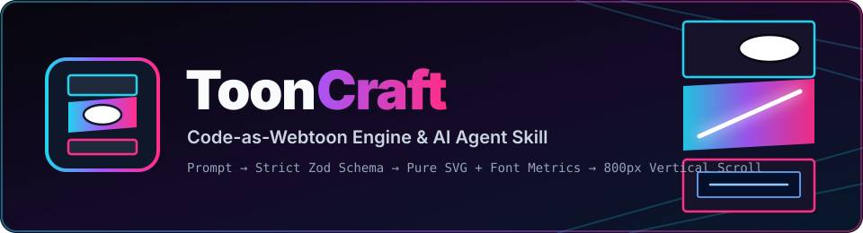

<p align="center">
  
</p>

<p align="center">
  <a href="https://github.com/janlucascc/tooncraft/actions/workflows/ci.yml"></a>
  <a href="./LICENSE"></a>
  = 20"/>
  
  
</p>

<p align="center">
  <strong>English</strong> · <a href="./README.pt-BR.md">Português (BR)</a>
</p>

---

**ToonCraft** is a **Code-as-Webtoon** engine and **AI Agent Skill** (inspired by how Remotion treats video) that transforms text prompts into vertical-scroll Webtoons / Manhwa episodes — rendered deterministically in pure SVG with real TrueType glyph metrics, procedural scenery, cel-shaded character silhouettes, comic lettering, SFX and Webtoon-ready smart-sliced exports.

**Zero diffusion APIs. Zero GPU bills. 100% reproducible from a single `story.json`.**

---

## Highlights

- **Dual Distribution:** Drop this repository into your agent's `skills/` directory (`SKILL.md` + progressive disclosure `references/`) **or** use it as a standalone TypeScript CLI / library.
- **Strict Zod Storyboard Schema (`src/schema/`):** Enforces cross-field integrity (unique IDs, valid character references, color syntax, pacing rules) with clear error paths so AI agents self-correct in one pass.
- **Real Font-Measured Lettering (`opentype.js`):** Bundles 6 SIL OFL TrueType fonts in `assets/fonts/` and measures real glyph advance widths & kerning so speech bubbles never clip or overflow.
- **8 Bubble Types & Seamless Tails:** `speech`, `thought` (cloud + dot trail), `shout` (starburst + jagged tail), `whisper` (dashed), `narration`, `system_window` (holographic RPG box with header), `phone_chat`, and `telepathy`.
- **Procedural Art Engine (No Image Gen):**
  - **8 Environments:** `cyberpunk-alley`, `neon-skyline`, `school-rooftop`, `dark-forest`, `dungeon-cavern`, `throne-hall`, `rainy-street`, `abstract-void`.
  - **7 Character Silhouette Presets:** `hooded-mage`, `armored-knight`, `cyber-assassin`, `casual-student`, `suit-detective`, `martial-artist`, `shadow-entity` — across 5 framings (`eyes-only` → `full-body`), 5 poses, 6 expressions, rim lighting and glowing eyes.
  - **Free-form `svg_raw` ("Remotion Mode"):** Agents can author custom vector blades, magic circles or props inside any panel — protected by a strict XSS whitelist sanitizer.
  - **10 Procedural Effects & 7 Emotion Badges:** radial/vertical speedlines, 45° halftone vignettes, rain, embers, mana particles, screen cracks, chromatic glitch, impact flashes, sweat drops, anger veins.
- **Interactive HTML5 Reader:** Self-contained single-file viewer with reading progress bar, Desktop (`800px`) / Mobile (`390px`) viewport switcher, Cinema/Paper reading rooms, keyboard shortcuts (`J`/`K`/`M`/`I`) and a built-in **Director Inspector**.
- **Webtoon Canvas / Tapas Smart Slicer (`@resvg/resvg-js` + `sharp`):** Rasterizes with bundled fonts (no headless Chrome) and slices long strips into `800×<=1280` PNG/WebP blocks at gutter midpoints or bubble-free horizontal bands — never cutting through speech bubbles.

---

## Installation

### 1. As an Antigravity / AI Agent Skill

Clone directly into your global or workspace skills directory:

```bash
git clone https://github.com/janlucascc/tooncraft.git ~/.gemini/config/skills/tooncraft
cd ~/.gemini/config/skills/tooncraft
npm install && npm run build
```

Then prompt your agent naturally:
> *"Use ToonCraft to create a 6-panel cyberpunk webtoon about two rival hackers meeting on a rainy rooftop."*

### 2. As a Standalone CLI / Project Dependency

```bash
git clone https://github.com/janlucascc/tooncraft.git
cd tooncraft
npm install
npm run build
```

---

## Quick Start (CLI)

```bash
# 1. Create a starter story.json
node dist/cli/index.js init ./my-episode

# 2. Validate schema + strict SVG safety
node dist/cli/index.js validate ./my-episode/story.json --strict-svg

# 3. Inspect pacing, word count and smart-slice plan
node dist/cli/index.js inspect ./my-episode/story.json

# 4. Render interactive HTML5 reader + 800x1280 WebP & PNG slices
node dist/cli/index.js render ./my-episode/story.json --format all --mode sliced --out ./out
```

---

## Showcase Examples

Run all three bundled episodes at once:

```bash
npm run validate:examples
npm run render:examples
```

| Example | Theme | Highlights |
| :--- | :--- | :--- |
| [`01-action-duel`](./examples/01-action-duel/) | `cyberpunk-neon` | Rainy alley, diagonal `eyes-only` cut, shattered splash with custom `svg_raw` plasma blade & `SLASH!!` SFX |
| [`02-dramatic-pause`](./examples/02-dramatic-pause/) | `noir-thriller` | Long `dramatic_pause` / `scene_transition` gutters with `fade-to-black`, `phone_chat`, `thought` cloud, `whisper` & `tremble` SFX |
| [`03-system-awakening`](./examples/03-system-awakening/) | `solo-system` | Dungeon throne hall, holographic `[ SYSTEM NOTIFICATION ]` window, `svg_raw` magic circle, curved `LEVEL UP!` SFX & glowing eyes |

---

## Programmatic API

```ts
import { composeEpisode, renderToHtml, exportToImages } from 'tooncraft';
import story from './examples/03-system-awakening/story.json' with { type: 'json' };

const composed = composeEpisode(story);
const html = renderToHtml(composed, { embedFonts: true });
const images = await exportToImages(composed, {
  format: 'webp',
  mode: 'sliced',
  outDir: './out',
});
```

---

## Development

```bash
npm run typecheck         # Strict TypeScript check
npm test                  # Vitest unit & E2E suite (schema, font metrics, layout, bubbles, sanitizer, rasterizer, CLI)
npm run build             # ESM bundle (tsup) + declarations (tsc)
npm run validate:examples # Strict schema + SVG validation of all examples
npm run render:examples   # Render all showcase examples to output/examples/
```

---

## License

Code is licensed under the [MIT License](./LICENSE). Bundled TrueType fonts in `assets/fonts/` are distributed under the SIL Open Font License 1.1 — see [assets/fonts/OFL-LICENSES.md](./assets/fonts/OFL-LICENSES.md).
