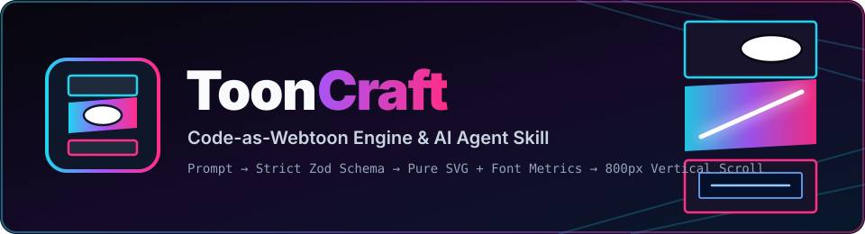

<p align="center">
  
</p>

<p align="center">
  <a href="./README.md">English</a> · <strong>Português (BR)</strong>
</p>

---

**ToonCraft** é uma engine **Code-as-Webtoon** e **Skill para Agentes de IA** (no espírito do Remotion para vídeo) que transforma prompts de texto em episódios de **Webtoon / Manhwa em scroll vertical** — renderizados de forma determinística em SVG puro com métricas reais de fontes TrueType, cenários procedurais, silhuetas cel-shaded, balões, onomatopeias (SFX) e exportação fatiada padrão Webtoon.

**Zero APIs de imagem generativa. Zero custo de GPU. 100% reproduzível a partir de um único `story.json`.**

---

## Principais Recursos

- **Uso Duplo:** Funciona como **Skill de Agente** (`SKILL.md` + manuais sob demanda em `references/`) ou como **CLI / biblioteca TypeScript** independente.
- **Schema Zod Estrito (`src/schema/`):** Valida referências de elenco, IDs únicos, cores, enquadramentos e pacing com caminhos de erro legíveis para humanos e agentes IA.
- **Letreiramento com Métricas Reais (`opentype.js`):** Embute 6 fontes TrueType open-source (SIL OFL) em `assets/fonts/` e mede a largura exata dos glifos com kerning para garantir balões perfeitamente dimensionados.
- **8 Tipos de Balões e Rabichos Sem Emenda:** `speech`, `thought` (nuvem + bolinhas), `shout` (estrela + rabicho elétrico), `whisper` (tracejado), `narration`, `system_window` (janela holográfica estilo RPG), `phone_chat` e `telepathy`.
- **Motor Visual Procedural (Sem IA de Difusão):**
  - **8 Cenários:** `cyberpunk-alley`, `neon-skyline`, `school-rooftop`, `dark-forest`, `dungeon-cavern`, `throne-hall`, `rainy-street`, `abstract-void`.
  - **7 Presets de Silhuetas:** `hooded-mage`, `armored-knight`, `cyber-assassin`, `casual-student`, `suit-detective`, `martial-artist`, `shadow-entity` em 5 enquadramentos (`eyes-only` até `full-body`), 5 poses, 6 expressões, *rim light* e olhos brilhantes.
  - **Camada `svg_raw` Livre ("Modo Remotion"):** Permite ao agente desenhar lâminas, círculos mágicos e objetos vetoriais dentro de qualquer quadro — protegida por sanitizador XSS de whitelist estrita.
  - **10 Efeitos Procedurais + 7 Badges de Emoção:** speedlines radiais/verticais, retícula 45°, chuva, brasas, partículas de mana, rachaduras de tela, glitch cromático, flash de impacto, gota de suor e veia de raiva.
- **Leitor HTML5 Interativo Autônomo:** Arquivo único com barra de progresso, alternância Desktop (`800px`) / Mobile (`390px`), modos Cinema/Papel, atalhos (`J`/`K`/`M`/`I`) e **Director Inspector** embutido.
- **Smart Slicer para Webtoon Canvas / Tapas (`@resvg/resvg-js` + `sharp`):** Rasteriza com as fontes embarcadas (sem Chromium/Puppeteer) e fatia em blocos `800×<=1280` PNG/WebP sempre priorizando gutters ou faixas livres de balões e SFX.

---

## Instalação Rápida

### Como Skill do Antigravity

```bash
git clone https://github.com/janlucascc/tooncraft.git ~/.gemini/config/skills/tooncraft
cd ~/.gemini/config/skills/tooncraft
npm install && npm run build
```

Depois, basta pedir no chat:
> *"Use a skill ToonCraft para criar um capítulo de manhwa cyberpunk de 6 quadros sobre dois duelistas em um beco chuvoso."*

### Como CLI Standalone

```bash
npm install
npm run build

# Criar episódio inicial
node dist/cli/index.js init ./meu-episodio

# Validar schema e segurança SVG
node dist/cli/index.js validate ./meu-episodio/story.json --strict-svg

# Inspecionar dimensões, pacing e fatias estimadas
node dist/cli/index.js inspect ./meu-episodio/story.json

# Renderizar leitor HTML5 + fatias PNG/WebP 800x1280
node dist/cli/index.js render ./meu-episodio/story.json --format all --mode sliced --out ./out
```

---

## Exemplos Inclusos

```bash
npm run validate:examples
npm run render:examples
```

1. [`01-action-duel`](./examples/01-action-duel/) — Duelo cyberpunk com quadros diagonais, `eyes-only`, lâmina `svg_raw` e SFX `SLASH!!`.
2. [`02-dramatic-pause`](./examples/02-dramatic-pause/) — Thriller noir demonstrando suspense vertical (`dramatic_pause` e `scene_transition` com `fade-to-black`).
3. [`03-system-awakening`](./examples/03-system-awakening/) — Fantasia de dungeon estilo *Solo Leveling* com `system_window` holográfica e círculo mágico `svg_raw`.

---

## Licença

Código distribuído sob [Licença MIT](./LICENSE). Fontes em `assets/fonts/` sob SIL Open Font License 1.1 ([OFL-LICENSES.md](./assets/fonts/OFL-LICENSES.md)).
